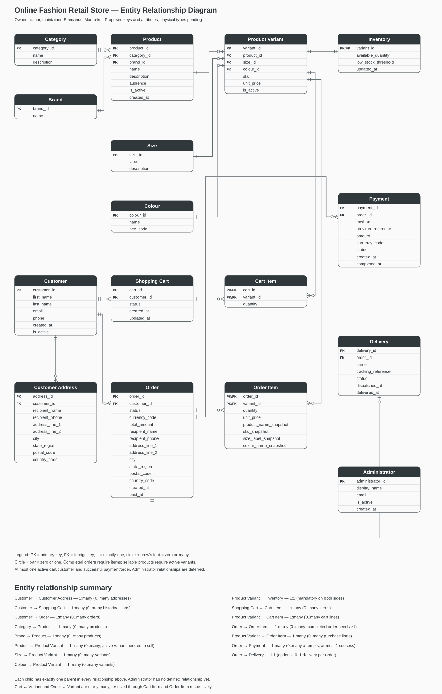

# Conceptual Entity Relationship Diagram

Owner, author, and maintainer: **Emmanuel Madueke**.

[Open the full-size ERD image](../diagrams/conceptual-erd.svg)

## Notation and scope

The image uses table boxes with dark headers, attribute rows, and a separate PK/FK column. PK denotes a primary key, FK a foreign key, and PK/FK both roles. Crow’s-foot connectors show relationships: double bars mean exactly one, a circle and crow’s foot mean zero or many, and a circle and bar mean zero or one. Every entity appears once.

The diagram includes proposed logical keys and attributes to match the requested table-style presentation. Physical data types and executable constraints remain pending. Administrator is an isolated staff identity pending a defined staff-action relationship. The SVG is the retained image artifact; no renderer script or Mermaid file is required.

## Relationship decisions

| Parent | Child | Children per parent | Parent per child | Rule |
| --- | --- | --- | --- | --- |
| Customer | Customer Address | 0..many | Exactly 1 | BR07 |
| Customer | Shopping Cart | 0..many | Exactly 1 | BR07–08 |
| Customer | Order | 0..many | Exactly 1 | BR07 |
| Category | Product | 0..many | Exactly 1 | BR01 |
| Brand | Product | 0..many | Exactly 1 | BR01 |
| Product | Product Variant | 0..many | Exactly 1 | BR02–03 |
| Size | Product Variant | 0..many | Exactly 1 | BR03 |
| Colour | Product Variant | 0..many | Exactly 1 | BR03 |
| Product Variant | Inventory | Exactly 1 | Exactly 1 | BR04 |
| Shopping Cart | Cart Item | 0..many | Exactly 1 | BR08 |
| Product Variant | Cart Item | 0..many | Exactly 1 | BR08 |
| Order | Order Item | 0..many generally; 1..many when completed | Exactly 1 | BR10 |
| Product Variant | Order Item | 0..many | Exactly 1 | BR10 |
| Order | Payment | 0..many attempts | Exactly 1 | BR13 |
| Order | Delivery | 0..1 | Exactly 1 | BR17 |

Cart Item resolves the many-to-many relationship between carts and variants. Order Item resolves the many-to-many relationship between orders and variants, retaining purchase-time facts.

## Rules the diagram cannot express alone

The Order–Order Item relationship uses zero-or-many because BR10 requires at least one item only for completed orders. An order can temporarily have no items while being constructed; finalisation must reject an empty order. Similarly, a draft product may have no variants, but a sellable product requires an active variant.

Customer–Cart cardinality includes historical carts; only one may be active. Order–Payment includes failed attempts; only one may succeed. These conditional rules require enforcement beyond the ERD.

Order stores its own delivery destination snapshot. There is no mandatory link from Order to Customer Address because the saved address can change or be removed without altering purchase history. Delivery records shipment progress and is optional until fulfilment starts.

Inventory is conceptually mandatory for every variant. A shared primary/foreign key prevents duplicate stock records but does not by itself guarantee every variant has one; the schema stage must select an enforcement strategy.

Administrator has no invented ownership link to customer orders. A later staff-audit requirement can introduce explicit relationships. Status transitions, totals, nonnegative stock, price snapshots, and atomic purchase finalisation remain documented business rules, not guarantees supplied by diagram lines.

## Validation and next step

The model contains all 16 proposed entities and all 15 documented relationships. Cardinalities were checked against the entity inventory and business rules; the SVG was checked for well-formedness and visually inspected. This is design evidence, not database runtime evidence.

Next: derive the relational schema and data dictionary, then analyse normalisation and implement integrity enforcement.

## Relationship ratios at a glance

The image footer lists every relationship and its minimum/maximum participation.

- **1:1:** Product Variant–Inventory (mandatory); Order–Delivery (optional delivery).
- **1:many:** Customer–Customer Address, Customer–Shopping Cart, Customer–Order, Category–Product, Brand–Product, Product–Product Variant, Size–Product Variant, Colour–Product Variant, Shopping Cart–Cart Item, Product Variant–Cart Item, Order–Order Item, Product Variant–Order Item, and Order–Payment.
- **Many:many:** Shopping Cart–Product Variant and Order–Product Variant, resolved through Cart Item and Order Item.
- **Administrator:** no relationship is defined in the current scope.

“Many” generally permits zero children; completed orders require at least one item, and sellable products require an active variant. Multiple carts include history; only one may be active. Multiple payments are attempts; at most one may succeed.
