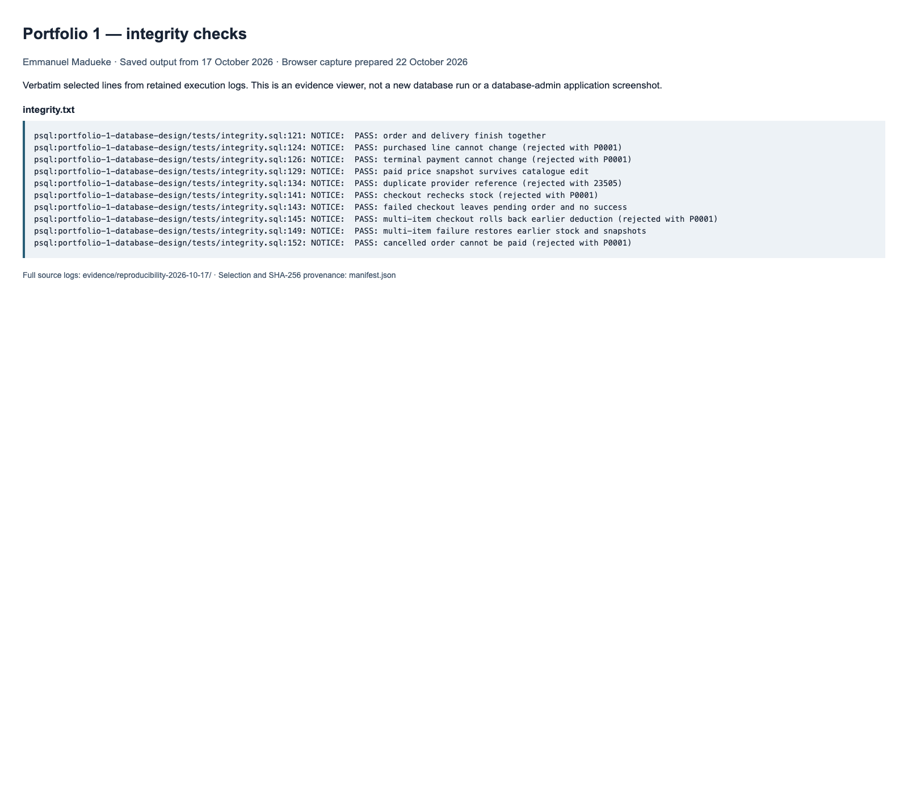
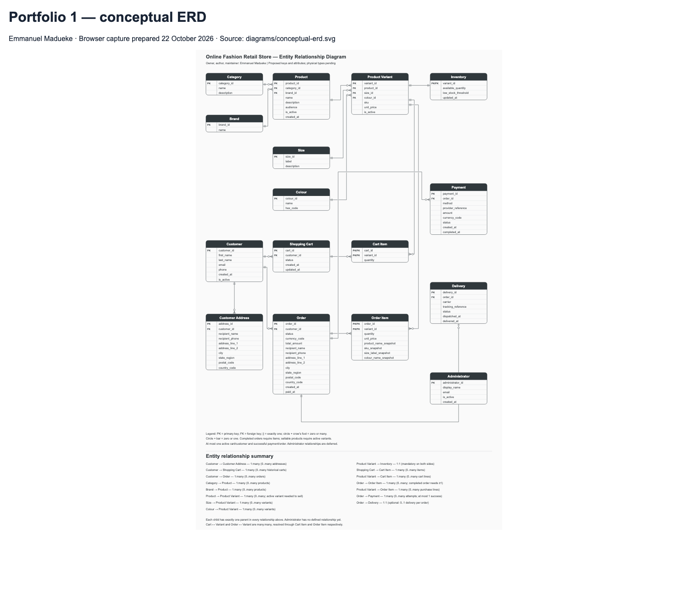
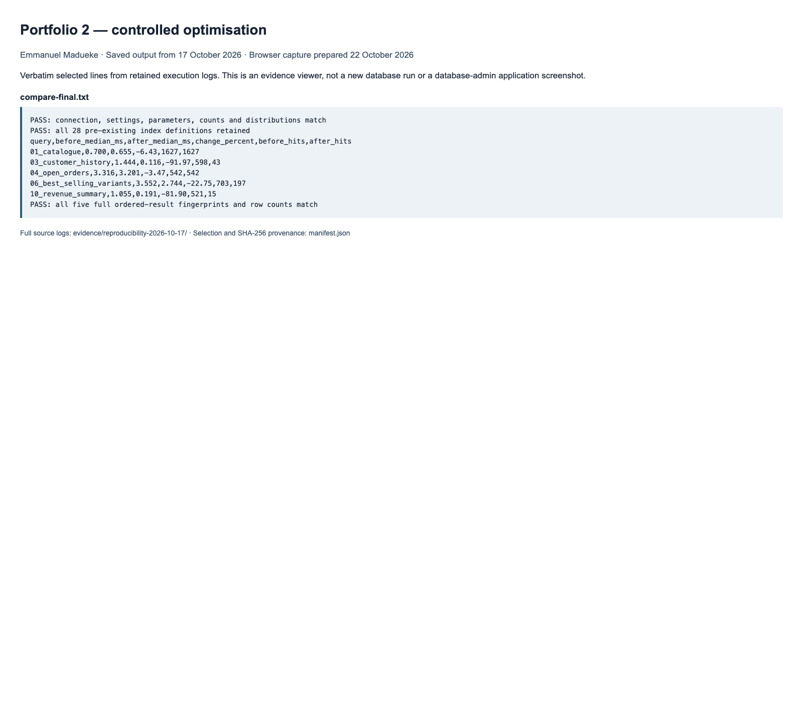
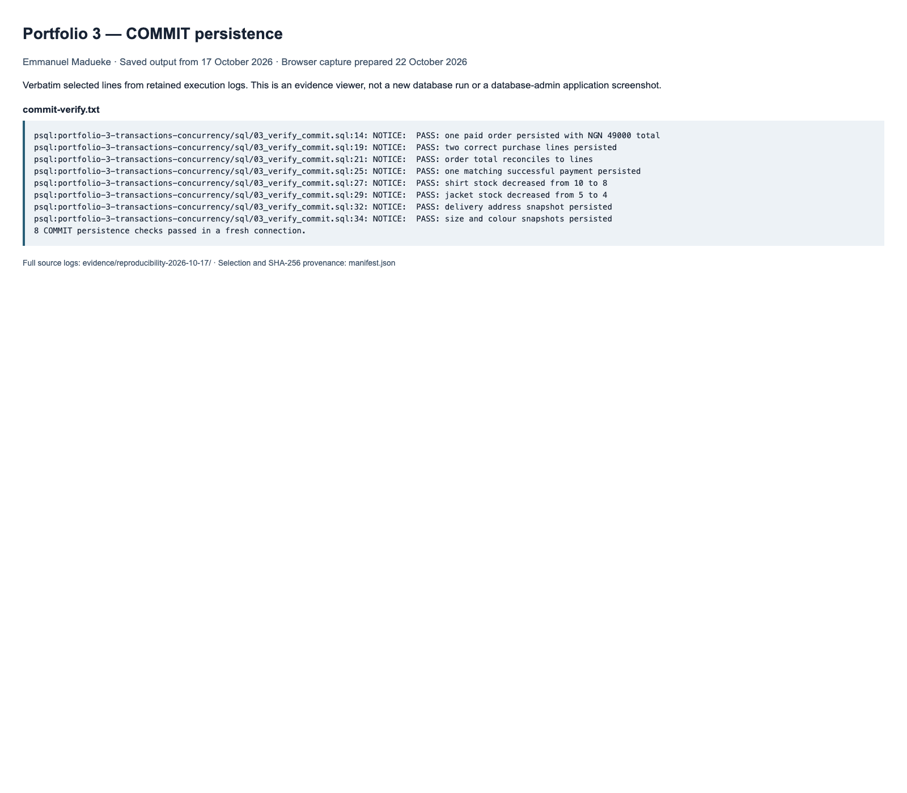
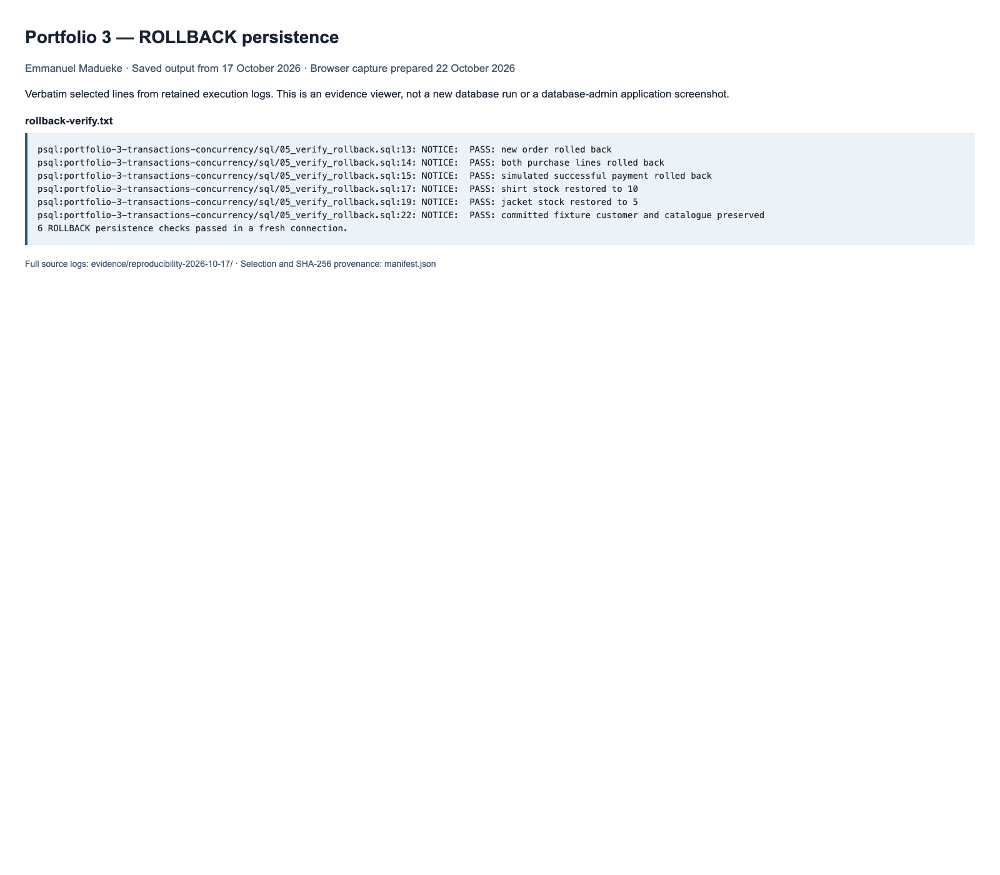
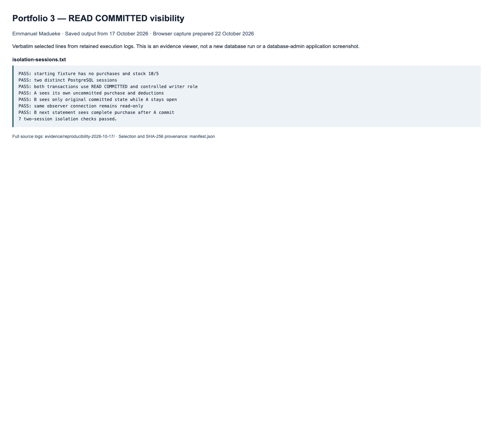
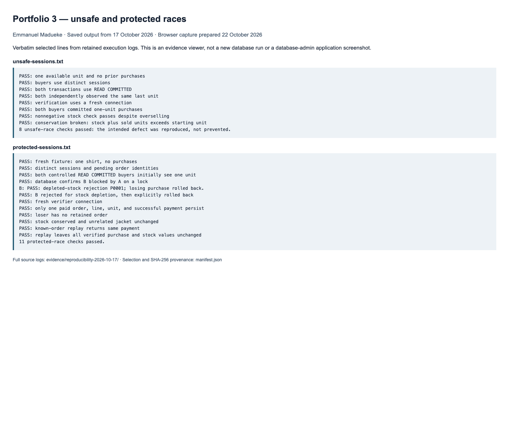
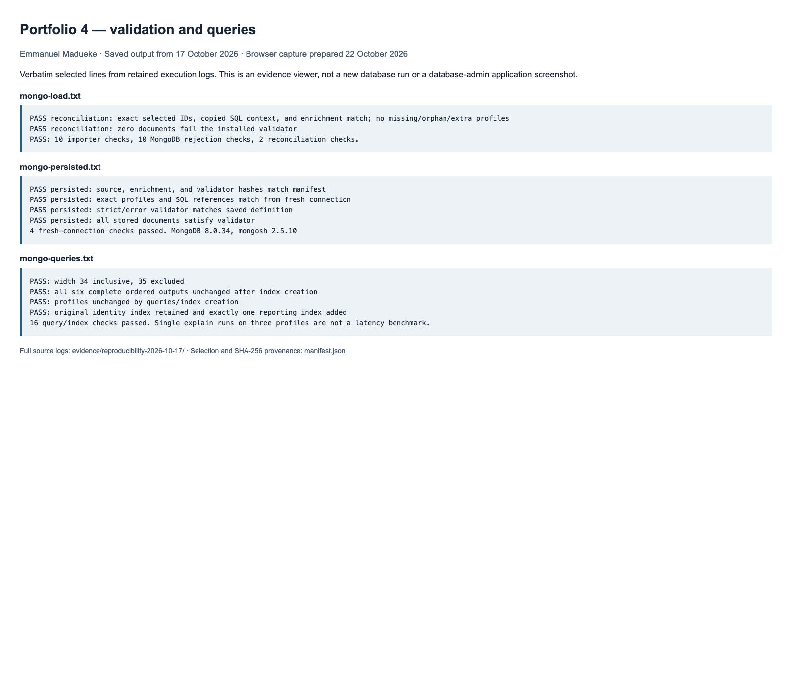
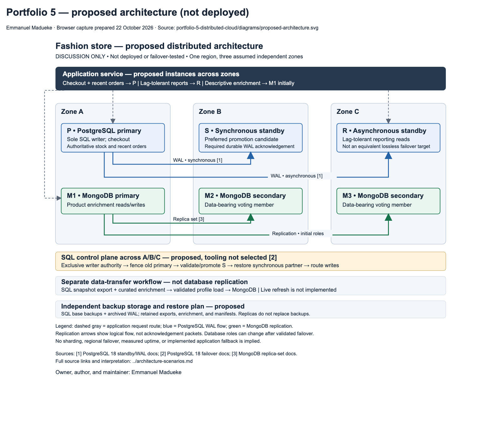

# Assessment screenshot gallery

Owner, author, and maintainer: **Emmanuel Madueke** · Student number: **301912318**.

Captured on **22 October 2026**. Sections 4–6 and 8 of the MIT 8103 brief request screenshots or output evidence. The repository already retained actual execution outputs; this gallery adds viewable PNG screenshots for the submission.

**Provenance:** these are actual browser captures of local evidence viewers displaying verbatim selected lines from the **17 October 2026** reproduction, plus the existing SVG diagrams. They are not screenshots of a fresh database session, pgAdmin, or MongoDB Compass. The [manifest](manifest.json) records original source paths, SHA-256 hashes, and selected line numbers. Full logs remain in the [reproduction evidence](../reproducibility-2026-10-17/README.md); HTML viewers are retained alongside the PNGs. No new database tests were run to produce these images.

## Portfolio 1 — schema and ERD

[Integrity source output](../reproducibility-2026-10-17/integrity.txt). The screenshot shows the final ten passing assertions; the full log contains all 35.

[Full-size ERD source](../../diagrams/conceptual-erd.svg). Use the SVG for detailed zooming.

## Portfolio 2 — execution-plan comparison

[Full comparison output](../reproducibility-2026-10-17/compare-final.txt). The measurements and result-equivalence statements are retained verbatim; raw plans remain in the reproduction directory.

## Portfolio 3 — COMMIT, ROLLBACK, isolation and concurrency

[COMMIT source](../reproducibility-2026-10-17/commit-verify.txt).

[ROLLBACK source](../reproducibility-2026-10-17/rollback-verify.txt).

[Isolation source](../reproducibility-2026-10-17/isolation-sessions.txt).

[Unsafe source](../reproducibility-2026-10-17/unsafe-sessions.txt) and [protected source](../reproducibility-2026-10-17/protected-sessions.txt).

## Portfolio 4 — MongoDB validation and queries

[Load source](../reproducibility-2026-10-17/mongo-load.txt), [persistence source](../reproducibility-2026-10-17/mongo-persisted.txt), and [query source](../reproducibility-2026-10-17/mongo-queries.txt). The image contains selected check summaries; full rejection cases and plans remain in the source evidence.

## Portfolio 5 — discussion diagram

[Original SVG](../../portfolio-5-distributed-cloud/diagrams/proposed-architecture.svg) and [scenario explanation](../../portfolio-5-distributed-cloud/architecture-scenarios.md). This image is a proposed architecture, not evidence of a deployed replica set or cloud environment.

## Capture and verification

The PNGs were captured by Chrome headless at a 1600 × 1400 viewport from the adjacent local HTML files. No terminal chrome or database application UI was fabricated. To repeat a capture, open a viewer in a browser or use Chrome's `--headless --screenshot=<new-output-path> --window-size=1600,1400` with its local file URL. Use a separate output path to preserve the retained images. Source excerpts can be checked against the manifest's line numbers and hashes.

The screenshots supplement the three-page summary; they do not expand its page count. Submit the requested PNGs alongside the PDF if supporting files are required by the LMS, and retain access to the complete repository evidence.
