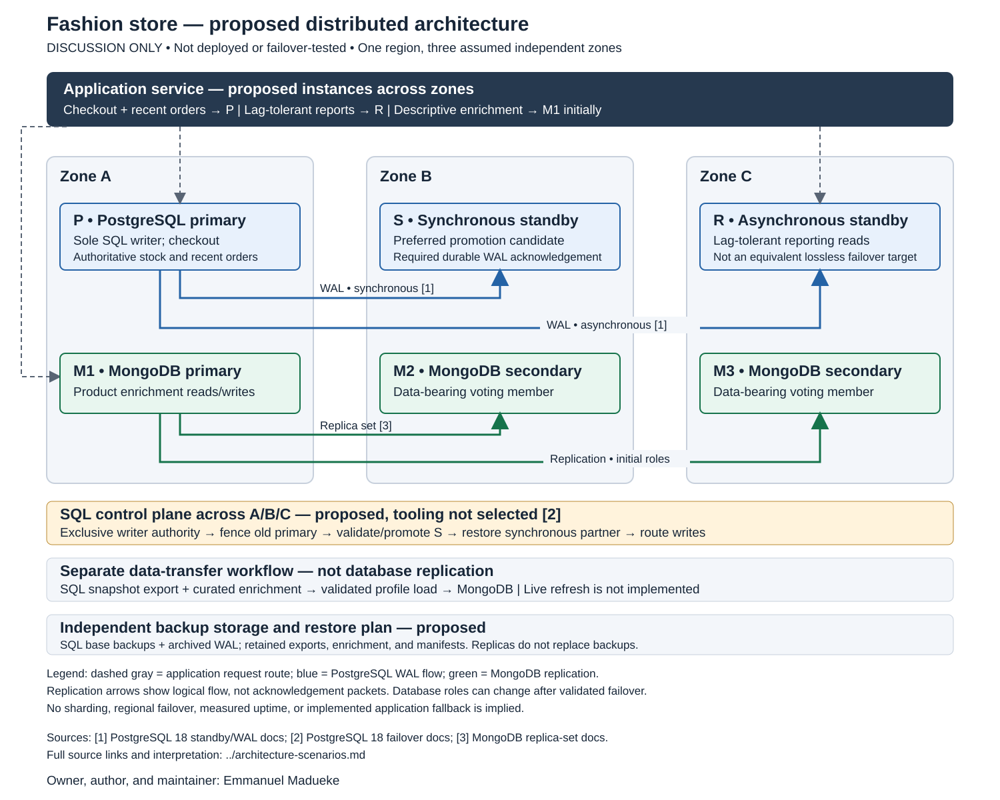

# Proposed architecture and failure scenarios

Owner, author, and maintainer: **Emmanuel Madueke**.

## Scope and diagram

This is discussion evidence for the existing fashion-store case study. **The distributed architecture is proposed, not deployed or failover-tested.** The local PostgreSQL and standalone MongoDB results from earlier activities do not verify the outcomes below.

[Open the full-size diagram](diagrams/proposed-architecture.svg). The image shows initial roles; successful failover would change the primary and application destination. Replication arrows represent logical data flow, not individual acknowledgements or a complete network configuration.

The design assumes one region with three independent availability zones. PostgreSQL P is the sole checkout writer; S is its required synchronous standby; R serves lag-tolerant reports. MongoDB M1/M2/M3 form a separate proposed replica set for descriptive enrichment. Application routing, failover control, fencing, monitoring, and backup storage remain design requirements. No cloud provider or control-plane product is selected.

The numbered diagram sources are:

1. **PostgreSQL replication and acknowledgement:** [PostgreSQL 18 warm standby](https://www.postgresql.org/docs/18/warm-standby.html) and [WAL settings](https://www.postgresql.org/docs/18/runtime-config-wal.html). With S configured as the required synchronous standby and `synchronous_commit=on`, successful commit acknowledgement waits for durable WAL flush on S; it does not guarantee replay visibility there. R is asynchronous.
2. **PostgreSQL promotion and fencing:** [PostgreSQL 18 failover](https://www.postgresql.org/docs/18/warm-standby-failover.html). Failure detection and orchestration require additional machinery; the old primary must be prevented from accepting writes before a replacement is used. The control-plane sequence is this portfolio's proposed policy.
3. **MongoDB membership and elections:** [Three-member replica sets](https://www.mongodb.com/docs/manual/core/replica-set-architecture-three-members/), [elections](https://www.mongodb.com/docs/manual/core/replica-set-elections/), and [replica-set write concern](https://www.mongodb.com/docs/manual/core/replica-set-write-concern/). The proposal uses three data-bearing voters and majority write concern. An eligible connected majority can elect a replacement primary; writes are interrupted during election.

The rationale and limitations are developed in [replication and availability](replication-availability.md) and [consistency and sharding](consistency-sharding.md). The separate snapshot-import arrow reflects the [implemented SQL/NoSQL boundary](../portfolio-4-nosql/sql-nosql-comparison.md), which has no continuous refresh mechanism.

## Concrete scenarios

All responses below are **expected behaviour or proposed operational policy**, not measured results. Recovery actions require a future implementation and controlled validation.

### 1. The SQL primary fails after an acknowledged purchase

**Trigger:** A customer buys the last black/medium shirt. The checkout succeeds, then zone A becomes unreachable.

**Expected response:** Stop routing checkout to P. Establish exclusive promotion authority and fence P before validating and promoting S. Under the stated synchronous acknowledgement policy, S should retain WAL for the acknowledged purchase; recovery must replay it before the new primary serves the corresponding state. R is not an equivalent lossless replacement because it may be behind.

**Proposed recovery and validation:** Re-establish a synchronous partner before reopening writes under the chosen durability policy. Confirm the known order, payment, and zero remaining stock on the promoted database; then verify another purchase is rejected. Measure detection, fencing, replay, and reopening separately. There is no demonstrated recovery time or guarantee against losing both durable copies.

### 2. The required synchronous standby becomes unavailable

**Trigger:** Zone B fails while P and the application remain reachable.

**Expected response:** Commits that require S can wait for acknowledgement. A client timeout does not prove rollback: the transaction may already have committed locally. This policy sacrifices write availability rather than silently changing to asynchronous durability. Previously committed reads may remain possible if P is healthy.

**Proposed recovery and validation:** Restore S or safely provision and catch up a replacement before restoring the acknowledgement path. In a future test, inspect blocked commits, client timeouts, and final order state. Record whether each request committed; do not equate an HTTP error with an absent purchase.

### 3. A report replica has not replayed the latest checkout

**Trigger:** P records stock zero and a paid order, while R still reports stock one and omits that order.

**Expected response:** Route recent-order reads and stock decisions to the current SQL writer. R's report is an older view, not authorisation to sell another unit. The protected checkout remains responsible for the stock check and deduction within one transaction. Even S can lag in replay despite durable WAL acknowledgement.

**Proposed recovery and validation:** Establish report freshness limits and lag monitoring before allowing replica reports in a deployed application. Pause replay in a future lab and verify that checkout rejects a second buyer while the report is stale. The [existing local concurrency evidence](../portfolio-3-transactions-concurrency/protected-concurrency.md) demonstrates row-lock protection only; it does not test replica routing.

### 4. A network partition leaves the old writer reachable by some clients

**Trigger:** The control plane loses contact with zone A, but some application instances can still connect to P.

**Expected response:** A missing heartbeat alone is insufficient permission to introduce a second writer. Promotion and traffic reopening must wait for exclusive authority and effective fencing of P. If that cannot be established, the proposed policy keeps checkout unavailable.

**Proposed recovery and validation:** Test infrastructure-level fencing and stale application connections, including attempts to write through an old connection after promotion. Rejoin the former primary only through a controlled recovery procedure. DNS or a load-balancer update alone does not prove that old sessions cannot write.

### 5. MongoDB loses its primary or its voting majority

**Trigger:** M1 fails while M2 and M3 remain connected; alternatively, only one member remains reachable.

**Expected response:** With two eligible connected members, an election can restore a primary, with an interruption to writes and primary-directed reads. A lone member cannot provide the chosen majority-write service. The proposed application uses primary read preference, so secondary-read fallback must not be assumed. See [MongoDB read preference](https://www.mongodb.com/docs/manual/core/read-preference/).

**Proposed recovery and validation:** Verify driver reconnection, majority-write results, and enrichment error handling in a future replica-set test. SQL checkout data is stored separately, but an application that waits indefinitely for enrichment can still obstruct customers. Serving basic SQL catalogue information without enrichment is a proposed fallback requiring implementation and testing.

### 6. All MongoDB replicas agree on an outdated SQL-derived flag

**Trigger:** A product is deactivated in PostgreSQL after the existing snapshot import. MongoDB still contains its previously copied active flag, and that document has replicated successfully to every member.

**Expected response:** MongoDB replication does not refresh a copy from PostgreSQL. Even a primary read can return the old imported value. Use authoritative SQL eligibility when deciding what may be purchased; do not infer cross-store consistency from replica agreement.

**Proposed recovery and validation:** Define a validated refresh process, freshness metadata, and ownership rules before claiming convergence. A future test should change SQL eligibility, observe the stale profile, run the refresh, and confirm reconciliation. The current fixed-snapshot importer establishes consistency with its input snapshot only.

### 7. The checkout response is lost after a possible commit

**Trigger:** The connection drops after checkout submission, leaving the customer unsure whether to retry.

**Expected response:** Treat the result as unknown until the known order can be checked on the current authoritative writer. Do not blindly create another order or charge. Replaying finalisation for a known order was checked locally, but this does not establish request-level idempotency for creating a new order.

**Proposed recovery and validation:** A deployed API needs a durable request identifier and a reconciliation path for ambiguous outcomes. Test response loss before and after commit and confirm one purchase per request. Real payment-gateway reconciliation is additional work; the portfolio uses simulated payment outcomes.

### 8. The region fails or an operator deletes valid data

**Trigger:** All three zones become unavailable, or an accidental deletion propagates through replicas.

**Expected response:** This single-region topology does not establish regional failover. Replication can propagate destructive changes, so additional live copies are insufficient recovery evidence.

**Proposed recovery and validation:** Retain independently protected backups and test restoration. PostgreSQL recovery would require usable base backups and archived WAL for the selected recovery target; see [PostgreSQL continuous archiving](https://www.postgresql.org/docs/18/continuous-archiving.html). Retained catalogue exports, enrichment data, and manifests would support reconstruction of the current snapshot-based MongoDB scope. Backup location, retention, recovery point, and recovery time remain undecided and unmeasured.

## Evidence boundary and next step

This stage supplies a sourced diagram and case-specific reasoning. The SVG was structurally checked and visually reviewed; documentation links were checked locally. **None of the eight failure scenarios was executed.** The proposed validation steps are future experiments, not test results or claims of Emmanuel's personal verification.

The [conclusions and evidence coverage](conclusions.md) now consolidate the assumptions, decisions, trade-offs, and references. No deployed configuration or availability measurements are claimed.
